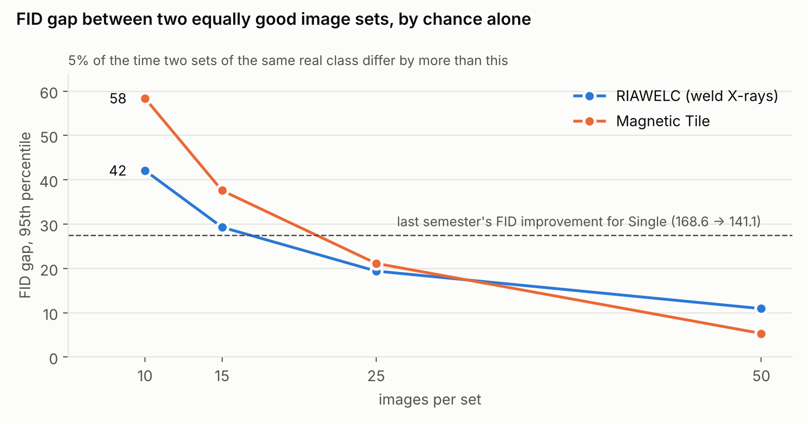
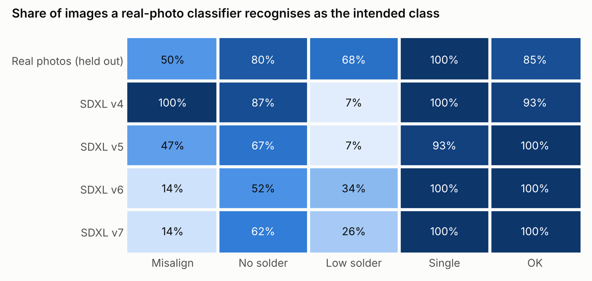
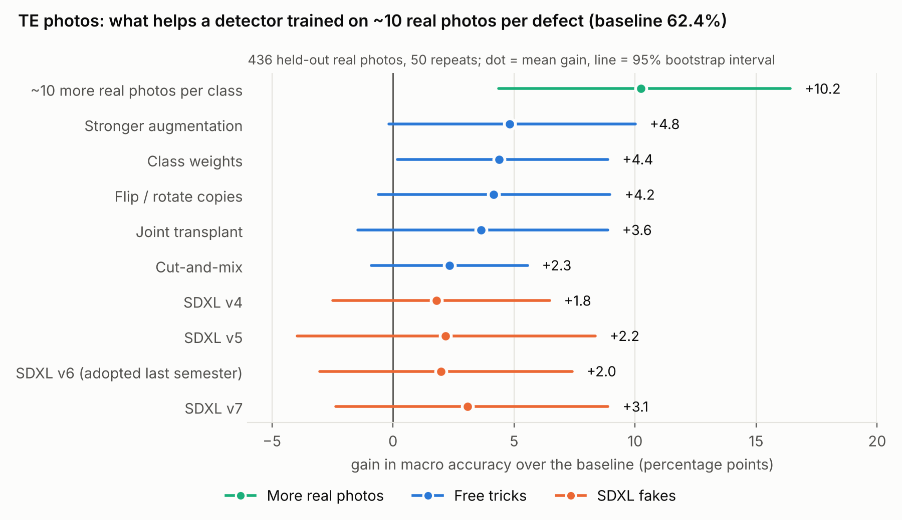
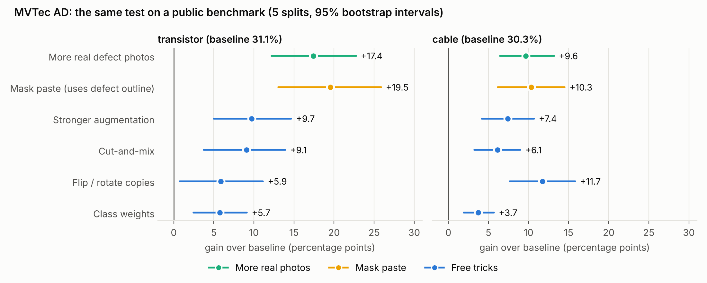

# Do synthetic defect images help a detector find real defects?

**UROP interim report** · Jaiswal Yasaswi · Supervisor: Prof Tang Kok Zuea, National University of Singapore<br>
Industry context: TE Connectivity's AI Toolkit (AITK), welded solder joints on the Whisper 112G cable<br>
UROP period Aug 2026 – Apr 2027 · Report date 16 Nov 2026

This repository holds the code, result tables and this report. TE's photos are not included (see [Data and confidentiality](#data-and-confidentiality)).

---

## Summary

AITK makes fake (synthetic) photos of rare defects with SDXL and a LoRA, then adds them to a defect detector's training set. Last semester's UROP team built the generator. This project tests, under fair conditions, whether those fakes actually help a detector on real photos it has never seen.

Main findings so far:

1. **The SDXL fakes do not measurably help yet.** On 436 held-out real TE photos, adding 15 SDXL fakes per defect raised macro accuracy by only 1.8–3.1 percentage points (pp). Every 95% interval includes zero. About 10 extra *real* photos per defect added **+10.2 pp** (95% interval +4.4 to +16.4). Free tricks that need no generator (augmentation, cut-and-mix, class weights) did as well as or better than SDXL, at +2.3 to +4.8 pp.
2. **The fakes often show the wrong defect.** A classifier trained on real photos recognises only 14% of SDXL v6 "Misalign" fakes as Misalign. 82% look like Low solder, and half of the v6 "Low solder" fakes look like good joints. The fakes are realistic-looking joints, not copies of training photos, but they don't carry the defect.
3. **Filtering the fakes with a judge did not fix it.** A judge trained on the same ~10 photos per defect accepted 49 of 50 v6 Misalign fakes, and the filtered fakes were no better (+1.8 pp).
4. **Several of last semester's measurements can't support their conclusions.**
    - With 10–15 images per set, FID moves by more than last semester's reported improvement (27.5) through chance alone.
    - 15-image test sets miss real gains up to 30% of the time.
    - In two of last semester's dataset versions, all 50 validation photos were also in the test set.
5. **Knowing where the defect is matters most.** On the public MVTec AD benchmark, pasting the defect region (cut out with its mask) onto good parts gave the largest gain on the transistor category, +19.5 pp, ahead of even extra real photos (+17.4 pp). This points to mask-guided generation as the next step.
6. **GPU work has started on NUS Vanda.** The full pipeline (session-grouped 5-fold splits, per-fold LoRA training, txt2img and img2img fakes, ViT detector) is built and being brought up on the cluster.

---

## Contents

1. [Background and question](#1-background-and-question)
2. [Data](#2-data)
3. [How methods are compared](#3-how-methods-are-compared)
4. [Results](#4-results)
5. [What the results mean](#5-what-the-results-mean)
6. [Current work: the GPU pipeline on Vanda](#6-current-work-the-gpu-pipeline-on-vanda)
7. [Plan for the rest of the project](#7-plan-for-the-rest-of-the-project)
8. [Limitations](#8-limitations)
9. [Repository layout and how to reproduce](#9-repository-layout-and-how-to-reproduce)
10. [References](#10-references)

---

## 1. Background and question

TE's inspection camera photographs every welded solder joint. Good joints are easy to collect, but defects are rare: about 100 photos of good joints against roughly 10 per defect type. That is too few to train a reliable detector.

AITK tries to close the gap with generated images:

- **SDXL** (Stable Diffusion XL) is the image generator.
- A **LoRA** is a small add-on trained on the few real photos of one defect, so SDXL learns what that defect looks like without being retrained.
- The fakes are added to the detector's training data.

Last semester's team produced four generator versions (v4–v7) and judged them mainly by FID and by a detector tested on small test sets.

**The question of this project:** when a detector has only about 10 real photos per defect, do generated photos improve how well it finds defects on *real* photos it has never seen? And if not, what would?

The five classes:

| Class | Meaning |
|---|---|
| OK | good joint |
| Misalign | the joint's parts are not lined up |
| NoSolder | no solder |
| LowSolder | not enough solder |
| Single | single electrode, TE's label for a type of missed weld |

## 2. Data

**TE photos.** The previous team's five dataset folders were pooled and de-duplicated by file content (`te/te_build_pool.py`):

| | OK | Misalign | NoSolder | LowSolder | Single | Total |
|---|---|---|---|---|---|---|
| Unique usable photos | 127 | 30 | 24 | 34 | 359 | 574 |

- **Set aside:** 7 photos carry two different labels (for example NoSolder and Single) and wait for TE's decision. 3 "too much solder" photos are not one of the five classes. With them, there are 584 unique photos in total.
- **Leak in the old splits:** in two of the dataset versions (`training_set`, `new_set_with_vae`), all 50 validation photos are also in the test set.
- **Last semester's generated images:** 15 per class for v4 and v5, and 50 per class for v6 and v7.

**Public datasets,** used to test the measurements and as a benchmark:

- **RIAWELC:** radiographs of weld defects, 4 classes, grouped by the film each crop came from.
- **Magnetic Tile:** surface defects on magnetic tiles, 6 classes.
- **MVTec AD:** the standard industrial benchmark, with a pixel mask for every defect. We use its transistor and cable categories.

## 3. How methods are compared

The laptop experiments use one fixed test, so that only the added images change between methods.

- **Training set:** the same photos the SDXL LoRAs were trained on, 100 OK and 9–10 per defect class. This is the AITK situation.
- **Test set:** all 436 other usable TE photos, none of which the generator or detector has seen: 27 OK, 20 Misalign, 15 NoSolder, 25 LowSolder and 349 Single.
- **Detector:** a frozen ImageNet ResNet-50 turns each photo into 2,048 numbers, and a logistic regression learns from them. It is fast enough on a laptop CPU to repeat every comparison 50 times.

Each method adds 15 extra images per defect class to the training set:

| Method | What it adds |
|---|---|
| SDXL v4 to v7 | last semester's fakes |
| Flip / rotate | flipped and rotated copies of the real photos |
| Stronger augmentation | real photos with crops, shifts, colour change and blur |
| Cut-and-mix | a patch from one defect photo pasted onto another of the same defect |
| Joint transplant | the joint cut out of a defect photo and blended onto a good part |
| Class weights | no images; each rare defect counts more in training |
| ~10 more real photos (ceiling) | half of the held-out real defect photos are lent for training, and the halves are then swapped |

Scores:

| Score | Meaning |
|---|---|
| Macro accuracy | the average of the five per-class accuracies, so the rare defects count as much as the 349 Single photos |
| Escape rate | the share of defects called OK |
| False-alarm rate | the share of good joints called defective |
| 95% interval | from 2,000 bootstrap resamples of the test photos; a gain whose interval includes zero might not be real |

## 4. Results

### R1. FID is too noisy at 10–15 images per set

Script: `exp1_fid_reliability.py`. Results: `outputs/results/exp1_*`.

FID compares two image sets, and lower means more alike. It was designed for thousands of images. Last semester reported FID for the Single class improving from 168.6 to 141.1, a 27.5-point gain, with about 10–15 images per set.

To see how much FID moves by chance, I compared two random sets drawn from the *same* real class: two "equally good generators".



| Images per set | Chance that two equally good sets differ by ≥ 27 FID: RIAWELC | Magnetic Tile |
|---|---|---|
| 10 | 14% | 26% |
| 15 | 7% | 12% |
| 25 | 2% | 1% |
| 50 | 0% | 0% |

At last semester's set sizes, an FID gain of that size often appears by chance. FID is also biased by set size: the FID between two sets of the *same* class falls from about 114 at 10 images to 26–32 at 150, so FID values from different set sizes can't be compared. KID stays near zero for same-class sets at every size (`exp1_summary.csv`), so this project uses KID together with the checks in R4.

### R2. 15-image test sets often miss real gains

Script: `exp2_fewshot_protocol.py`. Results: `outputs/results/exp2_*`.

I re-created last semester's "100 OK + 10 defects" training set on the public datasets. Each detector was scored on a 15-image test and on a large held-out test, over 50 random draws.

| Dataset | Method | True gain (large test) | How often the 15-image test said "no gain" |
|---|---|---|---|
| RIAWELC | flip / rotate | +4.7 pp | 30% |
| RIAWELC | class weights | +2.1 pp | 24% |
| RIAWELC | +15 real photos | +9.9 pp | 6% |
| Magnetic Tile | flip / rotate | +7.3 pp | 6% |
| Magnetic Tile | class weights | +5.6 pp | 2% |

Per-class accuracy on a 15-image test is off by about 9–12 pp on average, and by up to 43 pp (`exp2_test_noise_*.csv`). Comparisons on small test sets can therefore point the wrong way, and this project tests on hundreds of photos.

### R3. Split leakage inflates accuracy

Script: `exp3_split_leakage.py`. Results: `outputs/results/exp3_*`.

On RIAWELC (1,200 crops from 28 films), I compared a random split, where crops of the same film land on both sides, with a split grouped by film. Each was repeated 20 times.

| Classifier | Random split | Grouped split | Inflation |
|---|---|---|---|
| Logistic regression (balanced accuracy) | 93.8% | 84.1% | +9.7 pp |
| 1-nearest neighbour | 90.1% | 74.6% | +15.5 pp |

Together with the validation-in-test overlap found in two of the TE dataset versions (Section 2), this means last semester's reported test accuracies are likely optimistic. The new pipeline (Section 6) keeps photos from the same capture session on one side of every split.

### R4. What the SDXL fakes look like to a classifier

Script: `te/te_analysis.py`. Results: `te/te_outputs/te_class_fidelity*.csv`, `te_kid_fid.csv`, `te_memorisation.csv`, `te_diversity.csv`.

**Do the fakes show the intended defect?** A classifier trained only on real held-out photos labels each fake. The real row is measured by 5-fold cross-validation, as a reference.



- **v6 and v7 Misalign fakes are recognised only 14% of the time.** For v6, 82% are classified as LowSolder (`te_class_fidelity_confusion.csv`).
- **LowSolder fakes are recognised 7–34% of the time,** against 68% for real LowSolder photos. 50% of the v6 LowSolder fakes and 64% of the v7 ones are classified as **OK**. Fakes like that teach the detector that a defect is a good joint.
- **Single and OK fakes are recognised almost always,** but those are the easy classes.

**Other checks:**

| Check | Real photos | SDXL v4–v7 | Reading |
|---|---|---|---|
| KID to held-out real photos (lower = more alike) | 0.002–0.010 | 0.031–0.227 | Fakes are clearly distinguishable from real photos; the worst is v6/v7 Misalign at about 0.22. |
| Fakes closer to a training photo than any real held-out photo is | n/a | 0% for all sets except NoSolder v6 (2%) and v7 (12%) | Almost no copying of training photos. |
| Within-class similarity (higher = less varied) | 0.71–0.78 | 0.74–0.86 | Fakes are a bit less varied than real photos. |

### R5. Main result: do the fakes help a detector on real photos?

Script: `te/te_cheap_synth.py`, then `te/te_cheap_eval.py`. Results: `te/te_outputs/te_downstream_all.csv`.



| Method | Macro accuracy | Gain (pp) | 95% interval (pp) | Escape rate | False alarm |
|---|---|---|---|---|---|
| Baseline (100 OK + ~10 per defect) | 62.4% | n/a | n/a | 13.7% | 0.0% |
| **+ ~10 real photos per defect** | **72.6%** | **+10.2** | **+4.4 to +16.4** | **6.2%** | 2.7% |
| + 15 stronger augmentation | 67.2% | +4.8 | −0.2 to +10.0 | 9.5% | 0.7% |
| Class weights | 66.8% | +4.4 | +0.2 to +8.9 | 10.5% | 3.7% |
| + 15 flip / rotate | 66.6% | +4.2 | −0.6 to +9.0 | 10.2% | 0.8% |
| + 15 joint transplant | 66.0% | +3.6 | −1.5 to +8.9 | 10.7% | 1.1% |
| + 15 cut-and-mix | 64.7% | +2.3 | −0.9 to +5.6 | 12.2% | 1.8% |
| + 15 SDXL v4 | 64.2% | +1.8 | −2.5 to +6.5 | 11.4% | 0.0% |
| + 15 SDXL v5 | 64.6% | +2.2 | −4.0 to +8.4 | 8.8% | 3.3% |
| + 15 SDXL v6 | 64.4% | +2.0 | −3.0 to +7.4 | 11.2% | 2.1% |
| + 15 SDXL v7 | 65.5% | +3.1 | −2.4 to +8.9 | 10.8% | 2.1% |

- **Only the extra real photos give a gain that is clearly above zero.** Class weights' lower bound is just above zero in this run (+0.2 pp) and just below in a repeat run with different library versions (−0.3 pp), so I treat it as borderline.
- **SDXL v6 makes Misalign worse.** It lowers Misalign accuracy from 35.0% to 29.7%, consistent with its Misalign fakes looking like LowSolder (R4).
- **More fakes don't help.** Adding 50 v6 fakes per class gave +1.8 pp, no more than 15 did in the same run (`te_downstream.csv`).
- **Escape rate is where real photos matter most.** It halves from 13.7% to 6.2% with extra real photos, against 8.8–11.4% with SDXL fakes.

### R6. Can a judge filter out the bad fakes?

Script: `te/te_filter_test.py`. Results: `te/te_outputs/te_filter_*.csv`.

A common fix is to keep only the fakes that a "judge" classifier accepts. I tested this fairly. The judge was trained only on the detector's own training photos (each with 8 flipped and rotated views), so it never saw a test photo. A fake was kept if the judge labelled it as its intended class.

| v6 fakes kept by the judge | Misalign | NoSolder | LowSolder | Single |
|---|---|---|---|---|
| Kept out of 50 | 49 | 34 | 25 | 50 |

| Method (same test as R5) | Gain (pp) | 95% interval (pp) |
|---|---|---|
| + 15 flip / rotate | +4.0 | −0.7 to +8.6 |
| + 15 SDXL v6, unfiltered | +2.4 | −2.6 to +8.0 |
| + 15 SDXL v6, judge-filtered | +1.8 | −3.2 to +7.3 |
| + 15 SDXL v4–v7, judge-filtered | +3.0 | −2.0 to +8.4 |
| + 15 SDXL v4–v7, most confident | +1.4 | −4.6 to +7.5 |
| + ~10 real photos | +10.0 | +4.0 to +16.2 |

Filtering did not help. A judge that has seen only about 10 photos of a defect accepted 49 of 50 v6 Misalign fakes, the same fakes that a classifier trained on more real photos recognises only 14% of the time (R4). **A judge built from the same few photos as the generator is too weak to police it.** A pass rate from such a judge should not be read as evidence that the fakes are correct.

### R7. The same test on a public benchmark: MVTec AD

Scripts: `bench/bench_prepare.py`, `bench/bench_run.py`. Results: `bench/bench_outputs/`.

To check whether the TE picture is specific to TE's data, I ran the same test on two MVTec AD categories with the split used in the few-shot defect-generation literature (DFMGAN, AnomalyDiffusion):

- **Training:** 100 good images and a third of each defect type.
- **Test:** everything else, over 5 random splits.

MVTec provides a mask for every defect, so one more method was possible: **mask paste**, which cuts the defect out along its mask and blends it onto a good part.



| Method | Transistor gain (pp) | Cable gain (pp) |
|---|---|---|
| Mask paste | **+19.5** (+13.1 to +25.9) | +10.3 (+6.2 to +14.5) |
| More real defect photos | +17.4 (+12.2 to +22.7) | +9.6 (+6.4 to +13.2) |
| Stronger augmentation | +9.7 | +7.4 |
| Cut-and-mix | +9.1 | +6.1 |
| Flip / rotate | +5.9 | **+11.7** (+7.6 to +15.8) |
| Class weights | +5.7 | +3.7 |

- Baselines were 31.1% for transistor and 30.3% for cable.
- **Caveat on the ceiling:** MVTec has only about 10 images per transistor defect, so the real-photo ceiling could lend only 3–4 extra images per defect.
- **Mask paste raises false alarms,** from 1.3% to 7.0% on transistor and from 0.3% to 13.8% on cable, so it needs tuning.

The lesson carries over to TE: **methods that know where the defect is do best.**

## 5. What the results mean

1. **Judge fake images by what they do for a detector on many real photos.** FID on 10–15 images and 15-image test sets can't separate good methods from luck with this little data (R1, R2).
2. **A fake only helps if it shows the defect.** The current SDXL fakes are realistic joints but often with the wrong defect or none (R4), so they add little (R5), and a weak judge can't sort them (R6).
3. **The most promising direction is to control where and what the defect is.** Mask-guided methods (R7, and recent work such as DefectFill and DualAnoDiff) generate or paste the defect only inside a marked region of a real good part. For TE, this needs rough defect outlines on a small number of photos.
4. **A handful of extra real defect photos is still worth more than any generator tested.** If TE can collect even 5–10 more photos per rare defect, that is the cheapest improvement available.

## 6. Current work: the GPU pipeline on Vanda

The laptop tests used last semester's fakes and a quick stand-in detector. To answer the question properly, the GPU pipeline in [`hpc/`](hpc/) re-runs everything under clean conditions on the NUS Vanda cluster:

| Part | What it does |
|---|---|
| **Splits** (`make_splits.py`) | 5 folds grouped by 10-minute capture session (61 sessions), so burst photos never sit on both sides. Fold *k* is the test set, fold *k*+1 the validation set, and the other three are for training. Every photo is tested exactly once. |
| **Few-shot setting** | At most 10 real photos per defect and 100 OK photos, picked the same way for the generator and the detector. |
| **Generator** (`20_lora_train.pbs`) | One SDXL LoRA per fold and defect class, trained only on that fold's 10 training photos with last semester's v6 recipe: 512 px, rank 16, learning rate 1e-4, 1,500 steps, text-encoder LoRA. The fakes have never seen a test photo. |
| **Fakes** (`generate.py`) | 50 per class, made in two ways: txt2img (last semester's method) and img2img (SDEdit, a variation of each real training photo) at strengths 0.3, 0.45 and 0.6. 0.6 is the strength used in a parallel NUS project. |
| **Detector** (`vit_detector.py`) | Last semester's ViT-B/16, fine-tuned for 20 epochs. The best epoch is picked by validation macro accuracy. Scores are macro accuracy, escape rate and false alarms. |
| **Comparisons** | All real training photos; 10 real photos per defect (the baseline to beat); 10 real photos plus each kind of fake. |

Photos per fold:

| Fold | OK | Misalign | NoSolder | LowSolder | Single |
|---|---|---|---|---|---|
| 0 | 26 | 9 | 3 | 4 | 123 |
| 1 | 21 | 5 | 7 | 8 | 187 |
| 2 | 25 | 7 | 3 | 8 | 6 |
| 3 | 16 | 5 | 4 | 5 | 31 |
| 4 | 39 | 4 | 7 | 9 | 12 |

The Single class sits mostly in two capture sessions of 180 and 123 photos, so it can't be balanced. The other classes are spread so that every fold has at least 3 of each defect, and every training set at least 13.

**Status (mid-November 2026):**

- **Done:**
    - The environment is installed on Vanda: PyTorch 2.4 with CUDA 12.1, diffusers 0.31, and SDXL and ViT weights cached for offline GPU nodes.
    - The GPU test passed on an NVIDIA A40 (46 GB).
    - The splits are made.
    - The detector step runs end to end.
    - LoRA training runs at about 1.6 s per step, so about 40 minutes per LoRA.
- **Fixed:** two incompatibilities between diffusers' LoRA training script and offline GPU nodes (`hpc/fix_lora_script.py`).
- **Next:** an end-to-end smoke test, then the full run. The full run is 20 LoRAs, 20 batches of fakes and 6 detector runs, about 24 GPU-hours. With Vanda's limit of 4 concurrent jobs, that is roughly 6–8 hours of wall time.

## 7. Plan for the rest of the project

| When | Work |
|---|---|
| Nov 2026 | Full Vanda run (Section 6): honest ViT baselines; txt2img vs img2img fakes on session-grouped folds |
| Dec 2026 – Jan 2027 | Add SolDef_AI (real solder-joint photos) as a second public benchmark; repeat the key comparisons |
| Jan – Feb 2027 | Mask-guided inpainting: SDXL repaints only an outlined defect region on a real good joint. Start with LowSolder and Misalign, where the fakes fail most |
| Feb – Mar 2027 | Compare with published few-shot defect generators (e.g. AnomalyDiffusion) on MVTec AD; package the checks in this report (recognised-as-class, KID, copying, detector test on many real photos) as the "evaluate" step for AITK |
| Mar – Apr 2027 | Final experiments and final report |

**Open items with TE:**

1. The correct labels for the 7 double-labelled photos.
2. Rough defect outlines (boxes or masks) for about 10 photos per defect class, for mask-guided generation.
3. Confirmation that TE's photos may stay on NUS HPC storage.

## 8. Limitations

- **Laptop tests use a stand-in detector.** It is a frozen-feature classifier, not the fine-tuned ViT, so its absolute accuracies are not comparable with last semester's. All methods go through the same classifier, so the comparisons between them are fair. The Vanda run repeats the key comparisons with the ViT.
- **Some test classes are small.** The TE test set has only 15–27 photos per rare class, which is why the intervals are wide. Macro accuracy keeps the 349 Single photos from dominating.
- **The laptop TE test reuses last semester's LoRA-training split.** It is not session-grouped. A nearest-neighbour check found no near-identical pairs (cosine similarity > 0.95) across its training and test photos.
- **Class weights are sensitive to library versions.** Their gain differs between two runs (+3.0 and +4.4 pp); all other rows agree within 0.1 pp.
- **R7 covers only two MVTec categories** and a small real-photo ceiling.

## 9. Repository layout and how to reproduce

| Folder or file | Contents |
|---|---|
| [`README.md`](README.md) | This report |
| [`RUNNING.md`](RUNNING.md) | How to set up and run the laptop experiments |
| `report/make_figures.py`, `report/figures/` | The charts in this report, drawn from the result CSVs |
| `exp1_fid_reliability.py`, `exp2_fewshot_protocol.py`, `exp3_split_leakage.py`, `extract_features.py`, `outputs/` | R1–R3 on public datasets, with results and figures |
| [`te/`](te/) | R4–R6 on TE data: de-duplication and audit, SDXL quality checks, cheap fakes, detector test, judge filter; aggregate results in `te/te_outputs/` |
| `bench/` | R7: MVTec AD benchmark |
| [`hpc/`](hpc/) | GPU pipeline for NUS Vanda (PBS jobs, LoRA training, generation, ViT detector), with its own guide |
| `config.py`, `common.py`, `setup_data.py`, `run_all.py`, `run_step4.bat`, `tools/` | Shared settings, downloads and run scripts |

Quick start (laptop CPU; details in [RUNNING.md](RUNNING.md)):
```bash
pip install -r requirements.txt
python setup_data.py public     # public datasets for R1-R3
python run_all.py public
python setup_data.py te         # needs access to the previous team's data repository
python run_all.py te            # R4-R5; then python te/te_filter_test.py for R6
python report/make_figures.py   # re-draw this report's charts
```

### Data and confidentiality

TE's photos, last semester's generated images, the cheap fakes and every per-photo list (file names, capture times, labels) are **deliberately left out** of this public repository. Only code and aggregate results (accuracies, intervals, counts) are included. The data scripts download TE's photos from the previous UROP team's repository for people who have access. MVTec AD (CC BY-NC-SA 4.0) and the other public datasets are downloaded by the scripts from their sources and are not redistributed here.

## 10. References

- Heusel et al. *GANs trained by a two time-scale update rule converge to a local Nash equilibrium* (FID). NeurIPS 2017.
- Bińkowski et al. *Demystifying MMD GANs* (KID). ICLR 2018.
- Chong & Forsyth. *Effectively unbiased FID and Inception Score and where to find them.* CVPR 2020.
- Ravuri & Vinyals. *Classification accuracy score for conditional generative models.* NeurIPS 2019.
- Somepalli et al. *Diffusion art or digital forgery? Investigating data replication in diffusion models.* CVPR 2023.
- Carlini et al. *Extracting training data from diffusion models.* USENIX Security 2023.
- Kapoor & Narayanan. *Leakage and the reproducibility crisis in machine-learning-based science.* Patterns 2023.
- Duan et al. *Few-shot defect image generation via defect-aware feature manipulation* (DFMGAN). AAAI 2023.
- Hu et al. *AnomalyDiffusion: few-shot anomaly image generation with diffusion model.* AAAI 2024.
- *DefectFill: realistic defect generation with inpainting diffusion model for visual inspection.* CVPR 2025.
- *DualAnoDiff: dual-interrelated diffusion model for few-shot anomaly image generation.* CVPR 2025.
- Meng et al. *SDEdit: guided image synthesis and editing with stochastic differential equations.* ICLR 2022.
- Yun et al. *CutMix: regularization strategy to train strong classifiers with localizable features.* ICCV 2019.
- Li et al. *CutPaste: self-supervised learning for anomaly detection and localization.* CVPR 2021.
- Podell et al. *SDXL: improving latent diffusion models for high-resolution image synthesis.* 2023.
- Hu et al. *LoRA: low-rank adaptation of large language models.* ICLR 2022.
- Dosovitskiy et al. *An image is worth 16x16 words: transformers for image recognition at scale* (ViT). ICLR 2021.
- He et al. *Deep residual learning for image recognition* (ResNet). CVPR 2016.
- Bergmann et al. *MVTec AD: a comprehensive real-world dataset for unsupervised anomaly detection.* CVPR 2019.
- Huang et al. *Surface defect saliency of magnetic tile.* The Visual Computer, 2020.
- Previous UROP team's code and data: [github.com/TPH777/NUSxTE_UROP](https://github.com/TPH777/NUSxTE_UROP).
